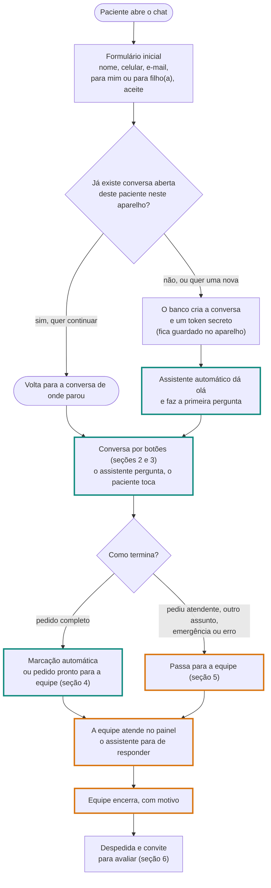
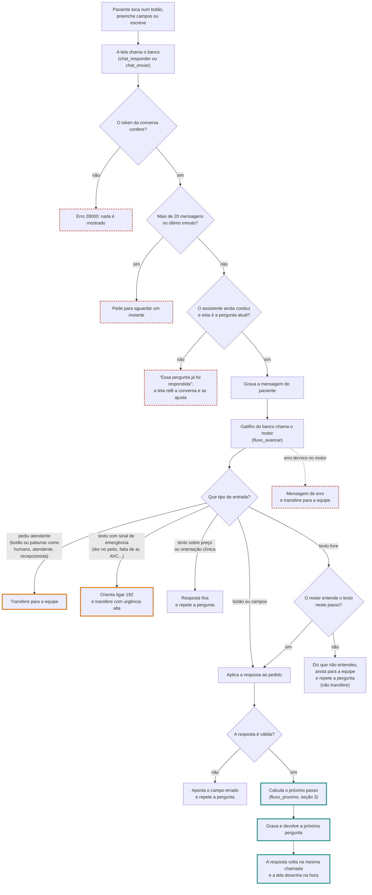
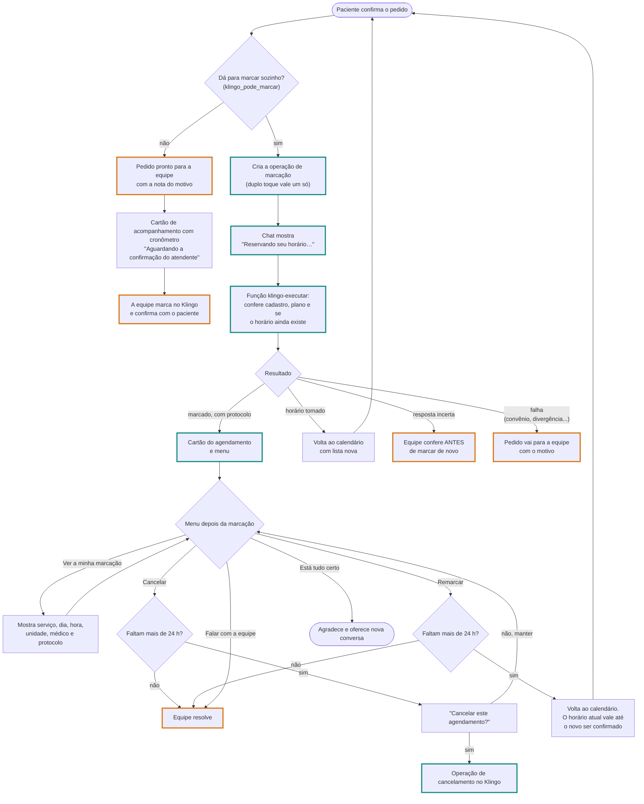
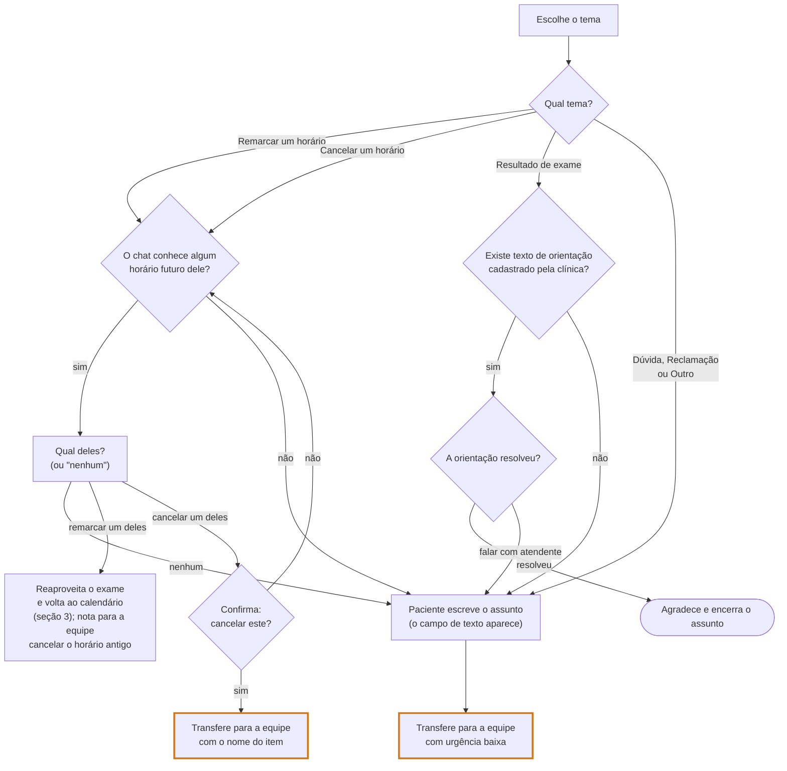
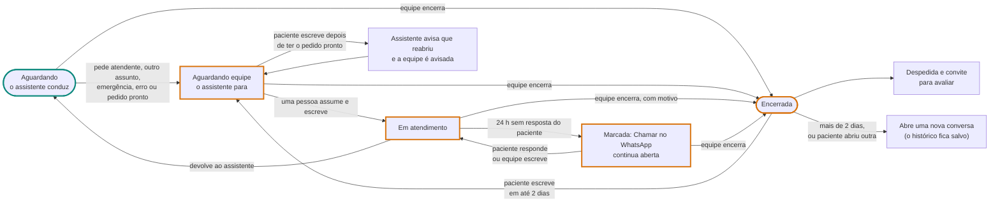
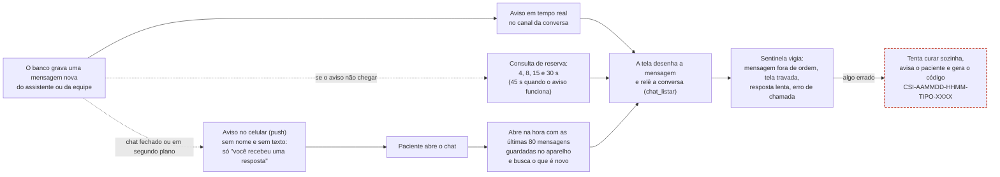

# Fluxograma da conversa do Webchat

Como o paciente conversa com o assistente automático e com a equipe, do formulário inicial ao encerramento.
Desenhado em 14/11/2026 a partir de `supabase/producao/funcoes/` e de `index.html` (`VERSAO_APP` 2026.11.13-7).
Borda **verde** = responde o assistente (o banco); borda **laranja** = responde uma pessoa da equipe; borda tracejada vermelha = erro ou recusa.

## 1. Visão geral: do primeiro toque ao fim do atendimento

O caminho completo de uma conversa. Cada caixa grande tem um fluxograma próprio mais abaixo.

- **Borda verde** = quem responde é o assistente automático (o banco); **borda laranja** = quem responde é uma pessoa da equipe.
- O chat só chama funções do banco com o token da conversa. Sem o token, nada aparece.
- Limite de abertura: 5 conversas por hora para o mesmo telefone. Se já havia uma conversa sem atendente da mesma pessoa, ela é encerrada como "nova conversa" e fica só uma.

## 2. O que acontece a cada toque do paciente

Vale para qualquer passo. Tudo isto roda no banco, na mesma chamada que grava a mensagem, e a resposta volta junto.

- A checagem de emergência só vale para **texto escrito**, não para botões.
- Pelo botão "Corrigir" (chat_voltar), o paciente volta à pergunta anterior; só funciona enquanto o assistente conduz e não funciona na primeira pergunta.
- Tempo medido: de 3 a 27 ms no servidor por passo (fase 7). O limite do paciente sem login é 3 s por chamada; acima disso dá o erro 57014.

## 3. Os passos do assistente, na ordem

A função fluxo_proximo olha o que o paciente já respondeu e decide qual é a próxima pergunta. Passo já respondido é pulado.

```mermaid
flowchart TD
  I(["Primeira pergunta"]) --> ID{"Cadastro antigo<br/>sem data de nascimento?"}
  ID -- "sim" --> ID1["Pede a data de nascimento"]
  ID -- "não" --> AT
  ID1 --> AT{"Paciente que volta,<br/>com pedido anterior?"}
  AT -- "sim" --> AT1["Atalho: repetir o último exame,<br/>continuar o pedido pela metade<br/>ou começar outro"]
  AT -- "não" --> MO
  AT1 --> MO["Motivo:<br/>Exame, Consulta ou Outro assunto"]
  MO -- "Exame" --> EX["Escolhe o exame:<br/>foto do pedido, mapa do corpo<br/>ou pelo nome"]
  MO -- "Consulta" --> CO["Escolhe a consulta<br/>(criança: pediatria / adulto: consulta)"]
  MO -- "Outro assunto" --> AS(["Seção 5"])
  CO --> ME{"Há mais de um médico<br/>para essa consulta?"}
  ME -- "sim" --> ME1["Escolhe o médico<br/>ou #quot;tanto faz#quot;"]
  ME -- "não" --> CN
  ME1 --> CN
  EX --> CN["CPF e data de nascimento<br/>(obrigatórios; o banco confere o CPF)"]
  CN --> PL["Plano:<br/>Particular ou convênio"]
  PL --> HO["Calendário:<br/>escolhe dia e horário<br/>(um por grupo de exames)"]
  HO -- "nenhum horário serve" --> PV["Lista de previsão (espera por vaga)<br/>ou anota para a equipe procurar"]
  HO --> MU
  PV --> MU{"Cadastro já conferido<br/>e completo?"}
  MU -- "sim" --> CF
  MU -- "conferido, mas<br/>falta algum dado" --> Q1{"Seus dados<br/>continuam os mesmos?"}
  Q1 -- "continuam" --> CF
  Q1 -- "mudaram" --> DI
  MU -- "paciente novo" --> DI["Dados de identificação:<br/>nome, sexo, nascimento, mãe, CPF"]
  DI --> DC["Dados de contato:<br/>celular, telefone, e-mail"]
  DC --> CF["Confirmar:<br/>resumo do pedido"]
  CF -- "corrigir" --> CR["Volta ao passo escolhido:<br/>pedido, plano, horário ou dados"]
  CR --> CN
  CF -- "tudo certo" --> FIM(["Seção 4: marcação ou pedido pronto"])
  class AS,FIM equipe
  classDef equipe stroke:#d9730d,stroke-width:3px
  classDef auto stroke:#0f8a7e,stroke-width:3px
  classDef problema stroke:#c0392b,stroke-width:2px,stroke-dasharray:5 3
```

- O endereço e a carteirinha **não são mais perguntados** (carteirinha saiu em 12/11/2026; o atendente confere o convênio depois).
- Consulta de médico só pergunta o médico se houver mais de um disponível. A conversa de um irmão copiada no modo "juntos" também pula essa pergunta.
- Quando uma oferta de horário já está pendente (pedido sem horário) ou a previsão está em andamento, essas perguntas passam na frente de tudo.

## 4. Depois da confirmação: marcação automática ou pedido para a equipe

Ao confirmar, o banco decide se pode marcar sozinho no Klingo. Se não puder (ou se a chave estiver desligada), o pedido segue para a equipe como sempre.

- **Marca sozinho só se:** a chave de marcação está ligada para essa conversa; há 1 só procedimento e 1 só horário; o horário veio da API do Klingo e ainda vale (até 20 min); CPF, nascimento, nome e sexo estão completos; o cadastro não está divergente; o plano tem tradução; e, se for exame, é Particular.
- Nada vira "agendado" sem protocolo (voucher) devolvido pelo Klingo. Resposta perdida vira **incerta**, nunca "tenta de novo".
- Mensagem de texto durante a marcação: "aguarde". Depois dela: reabre o menu.

## 5. Outro assunto: remarcar, cancelar, resultado, dúvida, reclamação

Quando o motivo é "Outro assunto", o assistente não monta pedido. Ele tenta resolver o que dá e passa o resto para a equipe.

- Remarcar por aqui reaproveita o pedido antigo e passa de novo pelos passos da seção 3. A equipe recebe a nota para cancelar o horário antigo.
- Não está desenhado aqui: a pergunta sobre exame em aberto ("você compareceu?"), que existe no motor (passos exame_aberto e remarcar_falta).

## 6. Estados da conversa: quem responde e quando fecha

A conversa passa por três estados. O assistente só responde enquanto está "aguardando" com a automação ligada.

- Desde 11/11/2026 a conversa **não fecha sozinha** por falta de resposta: ela fica marcada "Chamar no WhatsApp" para a equipe ir atrás do paciente.
- Encerrar pela equipe exige motivo. Encerrar como "Agendado" confere a agenda antes. O prazo para reabrir é `reabrir_dias` (hoje 2).
- Quando a equipe assume, os botões do assistente na tela do paciente se desligam sozinhos.

## 7. Como a tela do paciente fica em dia

O que mantém o chat atualizado sem o paciente fazer nada, e o que acontece com o chat fechado.

- Aba escondida por muito tempo fecha o canal; ao voltar, reabre e consulta na hora.
- A Sentinela nunca registra texto de mensagem nem dado pessoal. Se ela não carregar, o chat funciona igual.

## De onde saiu

- `index.html`: tela do paciente (VERSAO_APP 2026.11.13-7)
- `supabase/producao/funcoes/`: chat_iniciar, chat_responder, chat_enviar, chat_voltar, fluxo_avancar, fluxo_proximo, fluxo_aplicar, fluxo_perguntar, fluxo_finalizar, fluxo_transferir, fluxo_pos_responder, fluxo_assunto_aplicar, klingo_pode_marcar
- `docs/`: DOCUMENTACAO.md, fase7-motor-implementado.md, klingo-autoatendimento.md, autoencerramento.md
