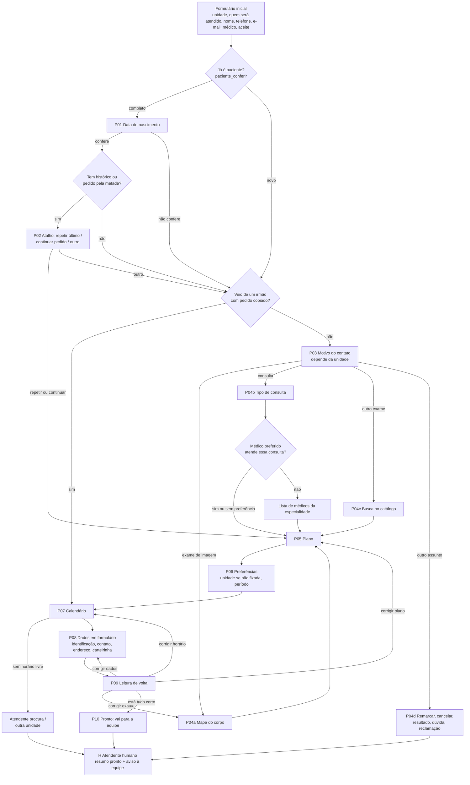

# Fase 7: o paciente recebe a resposta em menos de 1 segundo, sem a IA responder

Data: 31/10/2026. Base: a correção do n8n de 31/10 (`docs/n8n-correcao-2026-10-31.md`, PR #20), o prompt publicado no nó "Triagem com Claude" (versão `1ada4ac8`) e medições feitas no banco `webchat-atendimento` nesse dia.

## 1. Por que mudar

| Medida (banco real, 31/10/2026) | Valor |
|---|---|
| Respostas da IA medidas (mensagem do paciente → resposta) | 84 |
| Tempo típico (mediana) | **7,1 s** |
| 9 em cada 10 respostas chegam em até | **10,8 s** |

Quase todo esse tempo é o Claude: cerca de 10 mil tokens de entrada por mensagem. O resto são 4 chamadas ao Supabase e o n8n. Trocar por um modelo mais rápido (Haiku) deve cortar para algo entre 2 e 4 s (estimativa), não para menos de 1 s, e piora o cumprimento das regras. **A IA no caminho do paciente não chega a menos de 1 segundo.**

Além do tempo, a IA no caminho traz outros problemas:

- **Cota do n8n**: cada mensagem do paciente vira uma execução. Se a cota acaba, o chat para.
- **Falha da IA**: quando ela cai ou devolve JSON cortado, o paciente recebe "pode repetir?" ou vai para a fila humana.
- **Regras longas**: o prompt tem 13 blocos de regras (LGPD, preço, lado do exame, identidade, irmãos...). Cada regra nova é mais uma chance de ela desobedecer.
- **Custo**: créditos da Anthropic a cada mensagem.

O próprio prompt mostra que o atendimento já é um **roteiro fechado**: 7 etapas, uma pergunta por vez, quase sempre com lista, mapa ou calendário. Esse roteiro pode rodar como programa, sem IA.

## 2. A decisão

1. **Um motor de fluxo dentro do Supabase responde o paciente.** Ele roda na mesma chamada que grava a mensagem (`chat_enviar`), decide o próximo passo por regras fixas e devolve a resposta na hora. Não passa pelo n8n nem pela IA.
2. **A IA sai da conversa com o paciente.** O banco garante isso: com o motor ligado, a função `ia_responder_v2` recusa gravar mensagens.
3. **A IA trabalha nos bastidores.** Ela mapeia o processo, testa o fluxo com pacientes simulados, lê todo dia o que o motor não entendeu e propõe melhorias, que a equipe aprova. Ver a seção 6.
4. **Quando o motor não entende, ele não inventa.** Primeiro repete a pergunta com botões. Se não entender de novo, passa para um atendente com um resumo, e a mensagem vai para a lista de "não entendidos" que a IA estuda depois.

## 3. Como fica o caminho de uma mensagem

```
HOJE (7 a 11 s)
Paciente → chat_enviar → gatilho → n8n (webhook) → ia_contexto → ia_catalogo → Claude (5 a 10 s)
         → anti-duplicidade → ia_pre_agendar → ia_responder_v2 → Realtime → Paciente

FASE 7 (meta: 95% abaixo de 1 s)
Paciente → chat_enviar ─┬─ grava a mensagem do paciente
                        ├─ fluxo_avancar(): interceptadores → leitura da resposta → grava dados → próximo passo
                        ├─ grava a mensagem do assistente (com o componente)
                        └─ devolve a resposta na própria chamada → Paciente
         (Realtime continua avisando o painel e outras abas; o n8n só recebe avisos que podem esperar)
```

### Orçamento de tempo

| Trecho | Estimativa |
|---|---|
| Celular → Supabase em São Paulo (sa-east-1) e volta | 80 a 300 ms (depende da rede do paciente) |
| `chat_enviar` + `fluxo_avancar` (PL/pgSQL, consultas com índice) | 5 a 50 ms |
| Desenho da resposta no navegador | menos de 20 ms |
| **Total esperado** | **100 a 400 ms** |

A resposta volta **na mesma chamada** (`chat_enviar` passa a devolver a mensagem do assistente), então o navegador nem espera o Realtime. Os componentes que leem a agenda (`chat_horarios`) já são chamados direto pelo navegador hoje. O tempo deles será medido na Fase 7.1; se passar de 500 ms, entra cache por dia e unidade.

Medição permanente: cada passo grava em `fluxo_evento.ms` o tempo do servidor, e o chat envia o tempo que o paciente viu (do toque em Enviar até a resposta desenhada). O painel mostra a mediana e o pior caso de 95% por dia.

## 4. Mapa completo do processo

Montado a partir do prompt publicado, das instruções por unidade (`unidade_config.instrucao`), por quem será atendido (`atendimento_tipo.instrucao`) e das funções que já existem no banco.

### 4.1 Visão geral



### 4.2 Passo a passo

Os textos entre aspas são o ponto de partida. A equipe edita os textos no painel sem mexer em código (ver a seção 7). `{nome}` é o primeiro nome de quem conversa e `{paciente}` é o da criança quando `paciente_tipo = filho`.

| Passo | Quando entra | O assistente diz | Componente | Grava em | Confere | Próximo |
|---|---|---|---|---|---|---|
| **F** Formulário | Ao abrir o chat (já existe) | — | Formulário atual | `conversas` (unidade, médico, quem, irmãos), `contatos` | Telefone BR, aceite LGPD | P01 ou P03 |
| **P01** Identidade | `paciente_conferir` = completo e data ainda não conferida | "Olá, {nome}! Parece que você já é paciente da clínica. Para eu localizar o cadastro, qual é a data de nascimento {de {paciente}}?" | Campo de data | `pre_agendamentos.paciente.dt_nasc` | Data válida, compara com `pacientes` | Confere: P02. Não confere: segue como novo **sem dizer o motivo** (P03) |
| **P02** Atalho de quem volta | Identidade conferida e (`historico_paciente.ultimas` ou `pedido_pela_metade`) | "Da última vez foi {exame} ({parte}, {lado}) na {unidade}, em {data}. O que deseja agora?" Se `futuro`: "Você já tem {exame} marcado para {data}." | Lista: Repetir o último exame / Continuar o pedido que ficou pela metade (só se existir) / Fazer outro exame | `pre_reaproveitar('ultimo' \| 'pendente')` (já existe) | — | Repetir/continuar: P05. Outro: P03 |
| **P03** Motivo | Pedido vazio e não copiado do irmão | CSI: "Como posso ajudar, {nome}?" · Desenvoar: "Vamos agendar para {paciente}. O que precisa?" · RM/TC: pula direto para P04a · "Ainda não sei": a lista abaixo decide a unidade | CSI: Consulta / Exame de imagem / Outro exame / Outro assunto. Desenvoar: Consulta / Exame (por exemplo, eletroencefalograma) / Outro assunto. Sem unidade: Consulta pediátrica (vira Desenvoar) / Ressonância ou tomografia (vira RM/TC) / Outros exames ou consulta (vira CSI) / Outro assunto | `pre_agendamentos.tipo`; `conversas.unidade_inicial` quando estava em branco | — | P04a, P04b, P04c ou P04d |
| **P04a** Exames de imagem | Exame de imagem | "Toque no desenho para escolher o exame, a parte do corpo e o lado." | `pedido_exames` (mapa do corpo, já existe) | `pre_agendamento_itens` (já existe) | Lado e bilateral no servidor (já existe) | "Anotei: {lista}." → P05 |
| **P04b** Consulta | Consulta | "Escolha o tipo de consulta." | `pedido_consulta` (já existe) | `chat_consulta_salvar` (já existe) | Médico preferido x `catalogo_agenda` daquela especialidade | Atende: P05. Não atende: "Dr(a). {médico} não atende {especialidade}. Quer escolher outro(a)?" + lista dos médicos dessa especialidade + "Tanto faz" → P05 |
| **P04c** Outro exame | "Outro exame" ou exame da Desenvoar | "Qual exame? Pode escrever do jeito que está no pedido médico." | Texto, depois lista com até 5 resultados de `ia_catalogo` + "Não está na lista" | `pre_agendamentos.procedimento` | Siglas e erros comuns (já existe em `ia_catalogo`) | P05. "Não está na lista": grava o texto, avisa que o atendente confirma o exame → P05 |
| **P04d** Outro assunto | "Outro assunto" | "Sobre o que é?" e depois "Conte em poucas palavras." | Lista: Remarcar / Cancelar / Resultado de exame / Dúvida / Reclamação. Depois, texto | `conversas.triagem_resumo` | — | H |
| **P05** Plano | Pedido pronto | "O atendimento será particular ou por convênio?" | Lista de escolha única: Particular + até 8 operadoras aceitas na agenda desse procedimento (por uso) + Outro | `pre_agendamentos.plano` | "Outro" digitado: busca aproximada em `catalogo_plano` + `fluxo_sinonimo` → "Você quis dizer {operadora}?" Sim/Não | P06. Idade ou sexo fora de `idade_min`/`idade_max`/`sexo` do procedimento: avisa com delicadeza que o atendente confere e segue |
| **P06** Preferências | Plano gravado | Unidade (só se não estiver fixada **e** o procedimento existir em mais de uma): "Em qual unidade prefere?" · Período: "Qual período do dia prefere?" | Listas: unidades onde o procedimento tem agenda / Manhã, Tarde, Noite, Tanto faz | `unidade`, `preferencia_horario` | — | P07 |
| **P07** Data e hora | Preferências gravadas, ou pedido copiado do irmão | "Escolha o dia e o horário que preferir. É uma previsão: o atendente confirma." | `calendario` (já existe, um grupo de sala por vez) | `chat_horario_escolher` (já existe) | Horário ainda livre (já existe) | P08. Sem horário: "Não encontrei horário livre nos próximos dias." + lista: O atendente procura para mim (H) / Ver outra unidade (P06) |
| **P08** Dados | Horário escolhido | "Agora preciso dos dados de {paciente ou você} para o cadastro." Conhecido e conferido: "Seus dados mudaram desde a última vez?" Não → pula. Sim → mostra só os grupos | **Formulário novo** em 4 grupos: identificação (nome completo, sexo, data de nascimento, mãe, CPF, RG opcional) · contato (celular já preenchido com o telefone do formulário; outro telefone opcional) · endereço (CEP preenche rua, bairro, cidade e UF; número; complemento) · carteirinha (só convênio: número e validade) | `pre_agendamentos.paciente` | CPF com dígito verificador, data, CEP, UF, validade no futuro. Cada campo opcional tem "não sei agora" (o atendente completa). Criança: CPF dela ou "usar o do responsável" | P09 |
| **P09** Leitura de volta | Dados enviados | Texto montado pelo sistema: exames (parte e lado), plano, dia e horário (como previsão), unidade e dados (CPF só aqui) | Botões: Está tudo certo / Corrigir exame / Corrigir plano / Corrigir horário / Corrigir dados | — | — | Certo: P10. Corrigir: volta ao passo e depois retorna a P09 |
| **P10** Pronto | Paciente confirmou | "Pronto, {nome}! Um atendente vai conferir tudo, marcar no sistema e confirmar a data, o horário e o valor com você." Fora do horário de atendimento: acrescenta "Nosso horário é {horário}; respondemos assim que abrirmos." Irmãos que faltam: "Agora vamos para {irmão}." + botão "Agendar para {irmão}" (já existe) | — | `status = pronto`, `motor_ativo = false`, resumo | — | H |
| **H** Atendente | P04d, P07 sem horário, P10, interceptadores ou 2 falhas de leitura | "Um atendente continua com você em instantes." | — | `triagem_resumo` montado pelo sistema, `triagem_urgencia` | — | Fila do painel + aviso à equipe (n8n, em segundo plano) |

### 4.3 Regras que valem em qualquer passo (interceptadores)

Toda mensagem **digitada** passa por estes testes, na ordem, antes de ler a resposta do passo. Toque em botão não passa (já é uma resposta estruturada).

| Ordem | Detecta | Resposta fixa | Depois |
|---|---|---|---|
| 1 | **Emergência**: dor forte no peito, falta de ar, desmaio, sangramento intenso, sinais de AVC, convulsão, reação alérgica grave, pensamentos de se machucar. Na Desenvoar também: febre alta em bebê, desidratação, sangue nas fezes ou no vômito. Lista de termos e variações em `fluxo_sinonimo` (tipo `emergencia`) | "Isso pode ser uma emergência. Ligue agora para o **192 (SAMU)** ou vá ao pronto-socorro mais próximo." | Urgência alta → H |
| 2 | **Pedido de pessoa**: "atendente", "humano", "falar com alguém", "pessoa" | "Claro! Vou chamar um atendente." | H |
| 3 | **Preço**: "quanto custa", "valor", "preço" | "Quem informa o valor é o atendente, depois de conferir o plano e o exame." | Repete a pergunta do passo atual |
| 4 | **Orientação clínica**: "o que pode ser", "diagnóstico", "remédio", "posso tomar" | "Não consigo dar orientação médica por aqui; a equipe ajuda nisso." Mostra o **preparo** cadastrado do procedimento, se houver, sem mudar o texto | Repete a pergunta do passo atual |
| 5 | Resposta do passo (seção 5) | — | Próximo passo |
| 6 | **Não entendeu** | 1ª vez: "Não entendi. Pode escolher uma das opções abaixo?" e mostra de novo o componente. 2ª vez seguida no mesmo passo | H, e a mensagem vai para `fluxo_nao_entendido` |

O botão **"Falar com um atendente"** fica sempre visível no menu do chat, com o mesmo efeito do interceptador 2.

## 5. Como o motor lê o que o paciente digita, sem IA

| Tipo de resposta | Como lê |
|---|---|
| Botão, lista, mapa, consulta, calendário, formulário | Chega estruturado: `chat_responder(conversa, token, passo, valor)` no lugar do texto "Escolhi ...". Leitura exata, sem chance de erro |
| Lista digitada em vez de tocada ("manhã", "convenio bradesco") | Sem acento e em minúsculas, compara com os rótulos e com `fluxo_sinonimo`; busca aproximada (`pg_trgm`) com nota mínima. Só aceita se houver **um** candidato claro |
| Sim / não | Lista de variações: sim, s, isso, pode, ok, claro, correto / não, nao, n, errado, negativo |
| Data | dd/mm/aaaa, dd-mm-aa, dd.mm.aaaa, "5 de março de 1980" |
| CPF | 11 dígitos com dígito verificador |
| CEP | 8 dígitos; o navegador consulta o ViaCEP e preenche o endereço (o servidor não depende disso) |
| Telefone | Regras atuais do formulário (DDD + número) |
| Exame por texto (P04c) | `ia_catalogo`, que já entende siglas e erros comuns (RM, TC, US/USG, RX, "resonancia") e ordena pelo que a clínica mais faz |
| Plano por texto | `catalogo_plano` + sinônimos ("unimed", "hap vida") |

Mensagem livre longa no início ("Oi, quero marcar uma RM de pelve, tenho Hapvida") **não é perdida**: o motor tenta tirar dela o tipo de exame (via `ia_catalogo`) e o plano (via sinônimos), mostra o que entendeu nos componentes já marcados e pede só a confirmação. O que não reconhecer, pergunta normalmente.

## 6. Onde a IA trabalha (nunca falando com o paciente)

| Papel | Quando | O que faz | Quem decide |
|---|---|---|---|
| **Mapear o processo** | Agora e a cada mudança grande | Transformou o prompt de 13 blocos de regras no mapa da seção 4. A cada mudança, revisa se o fluxo cobre todas as regras (LGPD, lado do exame, identidade, irmãos, emergência) | Equipe e desenvolvimento |
| **Pacientes simulados** | Antes de ligar e a cada mudança do fluxo | Gera centenas de conversas de teste com perfis variados (idoso que escreve tudo numa frase só, mãe com três filhos, sigla errada, emergência no meio do cadastro, quem desiste no CPF) e roda contra o motor num banco de teste. Entrega a lista de onde travou | Desenvolvimento corrige |
| **Revisão diária** | 1 execução por dia no n8n (agendada, fora do caminho do paciente) | Lê `fluxo_nao_entendido`, as transferências do dia e o funil (onde o paciente desiste) e propõe em `fluxo_sugestao`: sinônimo novo, botão novo, texto mais claro, passo novo | Administrador aprova ou recusa na aba **Fluxo**. Sinônimo e texto aprovados entram na hora; mudança de passo vira tarefa de desenvolvimento |
| **Apoio ao atendente** (opcional) | No painel, quando o atendente pede | Sugere uma resposta ou um resumo para o **atendente** revisar e enviar | Atendente |
| **Curadoria do catálogo** | Semanal | Aponta exames sem região no mapa do corpo, duplicados e procedimentos muito pedidos sem preparo, e escreve o rascunho do preparo | Equipe aprova; o texto final vai para o Klingo |

Custo: de uma chamada à IA por mensagem para algumas chamadas por dia.

## 7. O que muda no banco, no chat e no painel

### Banco (arquivo novo `supabase/fase7-fluxo.sql`)

| Peça | Para quê |
|---|---|
| `config.motor` = `ia` \| `fluxo` (e `unidade_config.motor`, para ligar por unidade) | Liga o motor sem apagar nada; voltar atrás é trocar o valor |
| `conversa_fluxo` (conversa, passo, tentativas, dados, versão) | Em que passo cada conversa está |
| `fluxo_texto` (passo, chave, texto) | Textos que a equipe edita no painel |
| `fluxo_sinonimo` (termo, tipo, valor, origem, vezes) | Sinônimos de plano, exame, intenção e emergência; origem `manual` ou `ia_aprovada` |
| `fluxo_evento` (conversa, passo, entendido, ms, quando) | Funil, tempo de resposta e onde o paciente desiste |
| `fluxo_nao_entendido` e `fluxo_sugestao` | Matéria-prima e propostas da revisão diária |
| `fluxo_iniciar`, `fluxo_avancar`, `chat_responder` | O motor. A **lógica de passagem entre passos fica em código SQL testado** (muda por PR, com testes); os **textos e sinônimos ficam em tabela** (a equipe muda sem PR) |
| `fluxo_resumo` | Resumo para o atendente montado com os dados coletados, no lugar do resumo da IA |
| `chat_enviar` devolve a resposta do assistente | Desenho imediato no navegador |
| `avisar_n8n_mensagem` | Com o motor ligado, só dispara na transferência (aviso à equipe), não a cada mensagem |
| `ia_responder_v2` | Com o motor ligado, recusa gravar mensagem |

Reaproveitado sem mudança: mapa do corpo, consulta, calendário, reservas provisórias, conferência com o Klingo (Fase 3), paciente que volta (Fase 4), alerta de preço só para a equipe (Fase 6b).

A Fase 5 (Aprendizado) mede hoje os erros da IA. Ela passa a medir os do motor: o que o atendente corrigiu no pré-agendamento continua sendo registrado, agora por passo.

### Chat (`index.html`)

- Componentes novos: **formulário de dados** (P08, com validação no próprio celular e CEP preenchendo o endereço) e **leitura de volta** com botões de corrigir (P09).
- Toque em lista e calendário envia a escolha estruturada (`chat_responder`).
- Desenha a resposta que volta de `chat_enviar` na hora; o Realtime fica para mensagens do atendente.
- Botão fixo "Falar com um atendente" no menu.
- Mede o tempo que o paciente viu e envia junto com a próxima mensagem.

### Painel (`painel/index.html`), aba nova **Fluxo** (só administrador)

- Funil por passo: quantos entraram, quantos avançaram, onde desistem.
- Tempo de resposta do dia (mediana e pior caso de 95%).
- "Não entendidos" do dia, com a conversa ao lado.
- Sugestões da IA para aprovar ou recusar.
- Textos de cada passo, editáveis.

### Entrada única: WhatsApp e e-mail abrem a mesma página e o cache faz o login

**Decisão da equipe (31/10/2026):** os avisos vão por WhatsApp **e** por e-mail, e os dois levam para a mesma página. O paciente vai para o chat (`index.html`) e a equipe para o painel. A página usa o que já está guardado no aparelho para reconhecer a pessoa e entrar sem formulário.

**Paciente**

| Ao abrir a página | O que acontece |
|---|---|
| O aparelho tem a conversa em andamento | Abre direto nela, como já acontece hoje. Muda uma coisa: as últimas mensagens também ficam guardadas no aparelho e aparecem na hora, e as novas chegam logo depois |
| O aparelho tem o perfil (nome, telefone, e-mail), mas a conversa acabou | No lugar do formulário: "Olá de novo, {nome}!" com os botões **Continuar como {nome}** e **Não sou eu**. "Continuar" abre a conversa com os dados guardados; unidade e quem será atendido viram o primeiro passo do motor |
| O aparelho não tem nada (outro celular, cache apagado ou navegador interno do app) | O link da mensagem traz um **código pessoal** (`?c=...`). A página troca o código pela conversa, guarda no aparelho e tira o código do endereço. Sem código, aparece o formulário normal |

O código existe porque o cache nem sempre está lá. Em alguns aparelhos, principalmente no iPhone, o link tocado dentro do WhatsApp ou do app de e-mail abre num navegador interno, que não enxerga o que o Safari guardou. Sem o código, o paciente teria de preencher o formulário de novo.

Regras:

- **O cache só preenche o login, não libera dados.** A regra de login continua valendo (nome, telefone e e-mail batendo), e a data de nascimento continua obrigatória antes de usar qualquer dado do cadastro.
- **Código do link:** aleatório, abre só aquela conversa, vale 7 dias depois do encerramento e fica guardado no banco só como hash. Não dá acesso ao cadastro do paciente.
- **"Não sou eu" e "Sair"** (no menu) apagam do aparelho a conversa e o perfil. Isso cobre o celular emprestado ou da família.
- O `?origem=whatsapp` / `?origem=email` continua marcando de onde a pessoa veio (relatório do marketing).

**Página abrindo na hora:** o `sw.js` hoje busca a página na rede primeiro. Ele passa a abrir a cópia guardada na hora e a baixar a versão nova por trás, para a próxima abertura. A busca no cache ignora o que vem depois do `?` (`?origem`, `?c`), para não guardar uma cópia por link.

**Equipe:** o aviso de transferência traz o link `painel/?conversa=<id>`. O painel já guarda o login no navegador (sessão do Supabase), então abre direto na conversa. Se não houver sessão, pede o login e depois vai para a conversa. O WhatsApp e o e-mail da equipe levam só o primeiro nome, o motivo ("pré-agendamento pronto", "pediu atendente", "emergência") e o link. Nenhum dado de saúde nem do cadastro vai na mensagem.

**Dependências:**

- **WhatsApp:** precisa do número da clínica ligado à API oficial do WhatsApp Business (Meta) e de modelos de mensagem aprovados por ela, enviados pelo n8n.
- **E-mail:** precisa de uma credencial de envio no n8n (Gmail ou SMTP).
- **Aviso ao paciente:** vale para quando o atendente responde e ele não está com o chat aberto, e para a confirmação da marcação (Fase 3). Antes de ligar, conferir se o texto de aceite do formulário cobre receber esses avisos por WhatsApp e e-mail.

## 8. Ordem de trabalho

| Etapa | Entrega | Pronta quando |
|---|---|---|
| **7.0** | Este plano e o mapa do processo | A equipe revisou o mapa da seção 4 e respondeu as decisões da seção 9 |
| **7.1** | Motor no banco com `config.motor = 'ia'` (nada muda para o paciente) + testes automáticos de cada passo e interceptador (Postgres embutido, como os testes do PR #15) | Todos os passos e interceptadores com teste passando; `fluxo_avancar` abaixo de 50 ms nos testes |
| **7.2** | Chat: formulário de dados, leitura de volta, escolha estruturada, resposta direta, botão de atendente, medição de tempo. Entrada única: "Continuar como {nome}", código pessoal no link, "Não sou eu"/"Sair", `sw.js` abrindo do cache | Funciona no celular com `motor = 'fluxo'` numa conversa de teste, aberta pelo link do WhatsApp e pelo do e-mail, com e sem cache |
| **7.2b** | Avisos por WhatsApp e e-mail no n8n: à equipe a cada transferência (link do painel) e ao paciente quando o atendente responde ou a marcação é conferida (link do chat com código) | O link do aviso abre a conversa certa, já logado, no celular da equipe e no do paciente |
| **7.3** | Pacientes simulados pela IA + roteiro de teste manual (no formato de `docs/fase6-roteiro-de-teste-e-producao.md`) | Nenhuma conversa simulada trava sem ir para o atendente; emergência sempre detectada nos testes |
| **7.4** | Ligar por unidade: primeiro **CSI RM/TC** (fluxo mais curto: só mapa do corpo), depois **CSI**, depois **Desenvoar** | Alguns dias por unidade com 95% das respostas abaixo de 1 s e transferências por "não entendido" sob controle |
| **7.5** | Despublicar o fluxo `Triagem IA - Atendimento` do n8n. O n8n passa a ter só o aviso à equipe a cada transferência e a revisão diária | Uma semana sem nenhuma resposta da IA ao paciente |
| **7.6** | Aba Fluxo no painel e revisão diária da IA ligada | O administrador aprova a primeira leva de sugestões |

Voltar atrás em qualquer etapa: `config.motor = 'ia'` (enquanto o fluxo do n8n não for despublicado).

## 9. Decisões que são da equipe

1. ~~Canal do aviso de transferência~~ **Decidido em 31/10/2026:** WhatsApp e e-mail, os dois levando à mesma página, com login pelo cache (ver "Entrada única" na seção 7). Falta: o número da clínica na API oficial do WhatsApp e a credencial de e-mail no n8n.
2. **Horário de atendimento**: qual é, por unidade, e o texto que o paciente recebe fora dele.
3. **Quem aprova as sugestões da IA** na aba Fluxo.
4. **Texto livre no início**: manter o campo de texto aberto desde a primeira mensagem (o motor tenta entender e confirma) ou começar só com botões e liberar o texto depois? Recomendação: manter aberto, porque é como o paciente está acostumado no WhatsApp, e a seção 5 cobre os casos comuns.
5. **Dados em formulário (P08)**: hoje a IA pede um grupo de dados por mensagem. O formulário é mais rápido e erra menos (valida CPF e CEP no próprio celular). Confirmar que a equipe prefere assim.

## 10. Riscos

| Risco | Como fica coberto |
|---|---|
| Paciente escreve algo que o motor não entende | Repete com botões; na 2ª vez vai para o atendente com resumo. Nada é inventado. A revisão diária transforma esses casos em sinônimos e botões novos |
| Emergência escrita de um jeito que a lista não pega | Lista ampla e testada com pacientes simulados; cada transferência é revista pela IA no dia seguinte; o chat pode mostrar um aviso fixo sobre emergência (192) no topo |
| Fluxo fica "robótico" | Textos curtos, com o nome do paciente e da criança, editáveis pela equipe; as respostas chegam na hora, o que pesa mais para o paciente do que o tom |
| Mudança grande de uma vez | Chave `config.motor` por unidade, começando pela mais simples, com volta imediata |
| Segredo da IA escrito no fluxo do n8n | Já está na lista de pendências do fluxo. Com o motor ligado, o fluxo de triagem é despublicado e o segredo é trocado |
